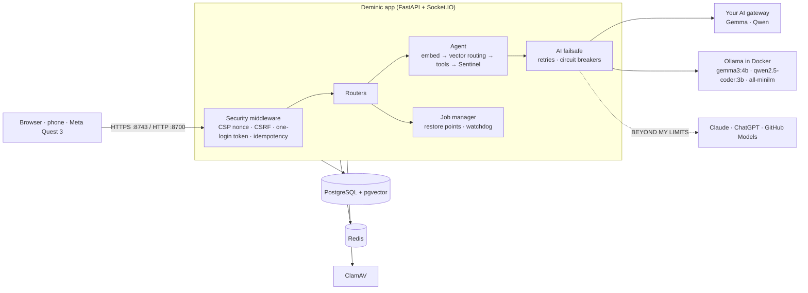

<div align="center">


# Deminic

### Your private, agentic AI for life, business &amp; code, running on your own hardware.

Deminic plans your day, guards your memories, runs your business desk and writes code that's scanned before it ever touches disk.
It runs on a **local Gemma / Qwen gateway** and calls Claude, ChatGPT or GitHub Models **only when a task is beyond its limits**.


[](LICENSE)

<br>

<a href="docs/media/hero.mp4"></a>

<sub>🤖 <b>AI caption</b>: <i>[[caption:hero]]</i></sub><br>
<sub><a href="docs/media/hero.mp4">▶ Watch in full quality (MP4)</a></sub>

</div>

## 🎬 Watch the demos

<div align="center">

**Five real screen recordings of the running app.** The answers come from the local AI, and nothing is mocked or sped up.<br>
<sub>Click a video to watch it in full quality. Each caption below was written by Gemma&nbsp;3 running locally, from frames of the video.</sub>

<table>
<tr>
<td align="center" width="33%"><a href="docs/media/chat.mp4"></a><br><b>💬 Live AI chat</b><br><sub><i>[[caption:chat]]</i></sub></td>
<td align="center" width="33%"><a href="docs/media/business.mp4"></a><br><b>💼 Business desk</b><br><sub><i>[[caption:business]]</i></sub></td>
<td align="center" width="33%"><a href="docs/media/coding.mp4"></a><br><b>🧑‍💻 Coding studio</b><br><sub><i>[[caption:coding]]</i></sub></td>
</tr>
<tr>
<td align="center" width="33%"><a href="docs/media/status.mp4"></a><br><b>📡 Live system status</b><br><sub><i>[[caption:status]]</i></sub></td>
<td align="center" width="33%"><a href="docs/media/hero.mp4"></a><br><b>🥽 Immersive VR mode</b><br><sub><i>[[caption:hero]]</i></sub></td>
<td align="center" width="33%" valign="middle"><b>Try it yourself</b><br><sub>Windows: <code>install.bat</code>, then <code>run.bat</code><br>macOS / Linux: <code>./install.sh</code>, then <code>./run.sh</code></sub><br><br><a href="#-quick-start"><b>Quick start ↓</b></a></td>
</tr>
</table>

</div>

---

## Why Deminic

<table>
<tr>
<td width="33%" valign="top">

**🏠 Truly yours**<br>
Runs on your PC, with every device on your Wi-Fi connected. Chats, health and financial data are encrypted at rest. No cloud account is needed.

</td>
<td width="33%" valign="top">

**🧠 Agentic, not just chatty**<br>
It doesn't just talk: it creates tasks, reminders, calendar events, clients, statements and e-mails. Say "stop reassuring me, save that to my notes" and it becomes a standing instruction. It never claims an action it didn't take.

</td>
<td width="33%" valign="top">

**🛡️ Safe by default**<br>
Includes a Sentinel AI guard, ClamAV scanning and an OSV.dev gate on every code write. One login per account, and restore points for anything risky.

</td>
</tr>
</table>

## 🌱 Where the ideas came from

Deminic Agentic AI didn't start from zero. It grew out of two of my earlier projects, and this is what each one gave it.

<table>
<tr>
<td width="50%" valign="top">

### 👥 [Deminic: employee management system](https://github.com/DHURJATI-JS/employee-management-system)

The original Deminic: hiring, attendance, payroll, tasks, meetings and chats for companies, with its own Deminic AI assistant.

- **The Deminic name and assistant**, grown from an HR helper into a full agent
- **The business side**: companies, tasks, calendars and pay became the business desk with clients, statements and payment reminders
- **Local AI first**: Gemma on your own hardware, with Claude only when you switch it on
- **One login per account**, ClamAV scanning of every upload, a nonce-based CSP, CSRF protection, rate limits and encryption at rest
- **Load-test results inside the app** (`/load-test` there, `/locust` here) and a one-click Windows installer

</td>
<td width="50%" valign="top">

### 🤖 [Elvin: autonomous coding agent](https://github.com/DHURJATI-JS/elvin-autonomous-coding-agent)

The agentic coder that plans, checks every library, asks before it acts and can undo anything.

- **The coding studio**: plan with Gemma, write with Qwen Coder, in a built-in code editor
- **The OSV.dev gate**: every library is checked for known vulnerabilities before code reaches disk
- **Restore points and crash safety**: multi-file changes are all-or-nothing and roll back, even after a crash
- **The failsafe model chain**: your gateway first, then Gemma and Qwen in Docker, then online models only when needed
- **GitHub, Locust load tests and live system status** built into the app

</td>
</tr>
</table>

What's new in Deminic Agentic AI is putting both together: **one assistant with personal, business and coding modes**, vector-routed tools and memory in pgvector, a Sentinel guard against prompt injection and cross-account leaks, and the immersive VR home page for Meta Quest 3.

## See it working

Every clip below is a real recording of the running app. The answers come from the local model; nothing is mocked.
The captions were written by **Gemma 3 running locally**, from frames of each recording.

### 💬 A live AI chat that does things

<p align="center"><a href="docs/media/chat.mp4"></a></p>
<p align="center"><sub>🤖 <b>AI caption</b>: <i>[[caption:chat]]</i><br><a href="docs/media/chat.mp4">▶ Full-quality MP4</a></sub></p>

### 💼 Business desk

<p align="center"><a href="docs/media/business.mp4"></a></p>
<p align="center"><sub>🤖 <b>AI caption</b>: <i>[[caption:business]]</i><br><a href="docs/media/business.mp4">▶ Full-quality MP4</a></sub></p>

### 🧑‍💻 Coding studio with a vulnerability gate

<p align="center"><a href="docs/media/coding.mp4"></a></p>
<p align="center"><sub>🤖 <b>AI caption</b>: <i>[[caption:coding]]</i><br><a href="docs/media/coding.mp4">▶ Full-quality MP4</a></sub></p>

### 📡 Live system status

<p align="center"><a href="docs/media/status.mp4"></a></p>
<p align="center"><sub>🤖 <b>AI caption</b>: <i>[[caption:status]]</i><br><a href="docs/media/status.mp4">▶ Full-quality MP4</a></sub></p>

## Three modes, one assistant

<table>
<tr>
<td width="50%" valign="top"><br>
<b>Personal</b>: tasks with locations and a same-name queue, reminders you can cancel up to 3 minutes before, a calendar with Google Calendar links, family profiles with e-mail, weather, a travel guide, movies (YouTube, or where to stream) and music, lawyer mode, and a private mind-map summary.</td>
<td width="50%" valign="top"><br>
<b>Business</b>: clients remember the chat they came from, and payment reminders disappear with the client. Also credit/debit statements, cold sales e-mails in a sent inbox, a daily news and opportunity digest, what-if simulations, and a live <code>{business_name}</code> variable.</td>
</tr>
<tr>
<td width="50%" valign="top"><br>
<b>Coding</b>: Qwen or online models only, a per-chat project plus a unified workspace, an editor with syntax colours, auto-closing brackets, undo/redo and SVG preview, an AI-suggested terminal, and GitHub (new branches only, never deletes).</td>
<td width="50%" valign="top"><br>
<b>Nothing unsafe reaches disk</b>: every save is checked against OSV.dev (with fixed versions or safer alternatives suggested), ClamAV and a secret scanner. Multi-file changes roll back completely if any file is blocked.</td>
</tr>
</table>

## 🥽 Immersive VR mode, built for Meta Quest 3

<table>
<tr>
<td width="50%"></td>
<td width="50%"></td>
</tr>
<tr>
<td colspan="2" align="center"><sub>Night brings stars, a moon, a nebula and shooting stars. Day brings a time-of-day sky with drifting clouds, hills and birds. Parallax follows your pointer or Quest controller, and a comfort layout switches on automatically on the headset. Any visitor can turn it on, signed in or not.</sub></td>
</tr>
</table>

## 📱 Every device on your network

<p align="center"></p>

The app listens on **HTTP :8700** and **HTTPS :8743**. A local certificate authority is generated so phones, tablets and the Quest 3 get HTTPS, which the microphone and location need: install `/ca.crt` once per device.

## How it works



1. **One embedding per message** drives everything: tool choice, memory recall and injection detection, all by nearest-neighbour search in pgvector.
2. **Failsafe chain**: your gateway, then the Docker fallback models, then online providers (only on `BEYOND MY LIMITS`). Cancelling is the last resort.
3. **Background jobs** stream over Socket.IO and can be cancelled by request id. Protected jobs (memory wipes, resets, multi-file code changes) open a **restore point** first and roll back if anything fails, even across a crash.
4. **Sentinel** redacts secrets and anything belonging to another account before a reply is saved or shown.

The app also has a full technical tour at **`/technical`** (architecture diagram, request journey, security layers).

## 🚀 Quick start

> Needs **Docker Desktop**. An OpenAI-compatible AI gateway on your network is optional: without one, Deminic uses its Docker fallback models.

**Windows**: double-click **`install.bat`**, then **`run.bat`**.

**macOS / Linux**:

```bash
./install.sh      # creates .env with fresh secrets, Python 3.12 via uv, PostgreSQL/pgvector, Redis, ClamAV, Ollama + models
./run.sh          # starts everything and opens the browser
```

| Option | What it does |
|---|---|
| `install.bat -Docker` / `./install.sh --docker` | Run the app itself in a container too |
| `install.bat -SkipModels` / `./install.sh --skip-models` | Skip downloading the fallback models |

Then open **http://localhost:8700**, create an account, and point **Settings → AI providers** at your gateway (for example `http://<gateway-ip>:8000/v1`).
On Windows, other devices need ports **8700/8743** allowed in the firewall (the installer asks once).

## 🔒 Security

| Layer | What it does |
|---|---|
| CSP with per-request nonce | Only this response's scripts run; no inline handlers and no third-party scripts |
| Signed double-submit CSRF and idempotency keys | Forged writes fail; a double click is replayed, not re-run |
| One login per account | A newer login invalidates older sessions (a hashed token in the database, checked by middleware) |
| Argon2id, Fernet field encryption | Passwords are never reversible; chats, health and finance data are encrypted at rest |
| Sentinel AI guard | Semantic prompt-injection detection, secret redaction, cross-account leak blocking |
| ClamAV, SSRF guard, rate limits | Uploads and clones are scanned; private and metadata addresses are refused; brute force is throttled |

## 🧪 Tested, not just written

- **83 / 83** automated tests: security, account isolation, restore points, all three modes, single login, N+1 query audit, status API, memory requests
- **27 / 27** AI evaluation cases run through the real gateway (outcomes checked in the database, not just text)
- **Load test**: 20 concurrent users for 4 minutes, 2,363 requests, **0.04 %** failures, and **0 leaks in 835** cross-account probes
- **Crash test**: the server is killed mid-way through a protected memory wipe, and everything is restored on restart

The latest report is served at `/locust`.

<p align="center"></p>

## Tech stack

FastAPI · SQLAlchemy 2 (async) · PostgreSQL 17 + pgvector · Redis · python-socketio · Jinja2 · Tailwind CSS · CodeMirror · Ollama · ClamAV · Locust · Playwright · pytest

## ⚠️ Disclaimer

**No liability.** Deminic is experimental software. Legal, medical, financial and code output can be wrong. Use it entirely at your own risk; the developer accepts no responsibility for any outcome. See `/disclaimer` in the app.

## 📄 License

Released under the **[MIT license](LICENSE)**: you can use, copy, modify and share it, as long as the license notice stays with it.
It's provided **as is, with no warranty**, and the author accepts **no liability or responsibility** for anything that comes from using it (see the disclaimer above).

## 👤 Developer

Built by **[dhurjati-js](https://github.com/dhurjati-js)**. Contact: [dhurjatisharma2010@gmail.com](mailto:dhurjatisharma2010@gmail.com)

<p align="center"><sub>Copyright © 2026 Dhurjati Sharma · <a href="LICENSE">MIT license</a> · no warranty, no liability</sub></p>
